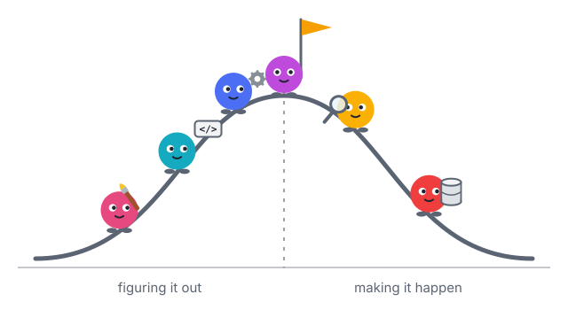

<p align="center">
  
</p>

<h1 align="center">shapeup-team</h1>

<p align="center"><em>Five agents. One hill. Nobody merges but you.</em></p>

---

You have an idea. Everyone has an idea.

The PO reads it, asks what people do today instead, and cuts it in half. Then cuts the half.
What's left fits on one page and says, in writing, what it won't do.

The founders bet on it. Or they don't, and it waits. Nothing carries over.

Then the crew walks up the hill.

**frontend-react** goes first, paintbrush in hand. Queries by role, never by CSS class. Has opinions about empty states.

**backend-drf** follows with a gear. Thin views, fat models, a service for anything with a side effect. Writes the failing test first, every time, and commits it so you can check.

**The PO** stands at the top holding the flag. Not to celebrate. To mark the line: past it, nothing new gets figured out. It only gets made.

**QA** comes down the other side with a magnifier. Wrote "Done when" before anyone wrote code. Will not let you change a test to make it pass.

**The DBA** carries the database like it's fragile, because it is. In production: backups. Only backups. And asks first.

Somewhere below, the Conductor counts rounds. At 75% of the budget, the scope gets hammered. At 100%, the build stops.
Nobody extends it but you.

They don't do standups. They write one row on the board and get back to work.

This plugin puts that crew inside Claude.

---

**What it is.** A Shape Up product team of Claude agents for a Django/DRF + Next.js/Chakra UI + Postgres/Cloud SQL product.
The main Claude session is the **Conductor**: it runs the phases, dispatches the roles and enforces the gates.
A hook blocks what the team must never do: work outside its area, rewrite git history, deploy, or write to production.
The process is fixed. How each role solves its step is up to the role.

## Install

| Where | How |
|---|---|
| Claude Code | `/plugin marketplace add tiagoafseixas/shapeup-plugin`, then `/plugin install shapeup-team@shapeup` |
| Claude app | Zip the repo contents (`zip -r shapeup-team.plugin . -x '.git/*' 'tests/*'`) and upload the `.plugin` file |

Needs `python3` on the PATH (the guard hook) and `gh` (branches and draft PRs). The [Ponytail](https://github.com/DietrichGebert/ponytail) plugin is recommended for code review.

## How a pitch moves

| # | Phase | Who | Output | Command |
|---|---|---|---|---|
| 0 | Setup (once per repo) | Conductor + CTO | `shape/team.md` filled | `/gate setup` |
| 1 | Shape | CTO + PO | `pitch.md` with status `ready`, `log.md` | `/shape` |
| 2 | Bet | Founders | Pitch status `bet` with a cycle id | — |
| 3 | Kickoff | Conductor → all roles | Branch, draft PR, board with scopes, `tech.md` | `/kickoff` |
| 4 | Build | Roles, in rounds | Scopes move over the hill to done | `/round` |
| 5 | Ship | QA → Conductor | PR marked ready, runbook if ops are needed | `/gate ship` |
| 6 | Cool-down | Conductor + PO | Retro; cut items in `shape/ideas.md` | `/round` (after the merge) |

Appetite is a round budget, not a calendar: Small batch 8 rounds, Big batch 20 by default. At 75% the PO hammers scope; at 100%
the build stops and the default is drop and re-shape. Only the CTO extends.

## Commands

| Command | Does |
|---|---|
| `/shape [idea or slug]` | Shapes a pitch with the CTO; role agents run read-only tech checks; Ready gate |
| `/kickoff <slug> <cycle>` | Branch `cycle/<cycle>-<slug>`, draft PR, board, scope map, `tech.md`, Kickoff gate |
| `/round <slug> [count]` | Runs build rounds (PO → DBA → backend-drf → frontend-react → QA), applies the circuit breaker, batches questions for the CTO |
| `/gate <setup / ready / kickoff / scope S<n> / ship> <slug>` | Runs one gate and logs the result |

## Roles

| Agent | Role | Default model | May edit |
|---|---|---|---|
| `product-owner` | PO: answers questions during the build, hammers scope, guards no-gos | Sonnet | `shape/**` except `team.md` |
| `backend-drf` | Django + DRF: thin views, fat models, service layer | Sonnet | Backend path; the pitch's `tech.md`, `board.md`, `log.md` |
| `frontend-react` | Next.js App Router + Chakra UI v3 | Sonnet | Frontend path; the pitch's `tech.md`, `board.md`, `log.md` |
| `qa-engineer` | QA: "Done when" checks, Scope and Ship gates, Large tests | Sonnet | Test files; the pitch's `board.md`, `log.md` |
| `dba` | Postgres + Cloud SQL: migration review, indexes, runbooks, backups | Opus | Migrations; the pitch's `tech.md`, `runbook.md`, `board.md`, `log.md` |

Shaping runs in the main session on Opus. The Conductor drops a turn to Haiku when the work is fully specified, and escalates one
step up when a turn fails. Call a role directly by name: "DBA, review migration 0008 on deal-win-tracking".

## Guardrails (hook-enforced)

The guard runs before every `Write`, `Edit` and `Bash` call in a repo with `shape/team.md`, and on every call made by a team agent.

| Blocked | Asks the CTO first |
|---|---|
| Edits outside the role's area (Roles table) | `gcloud sql backups create` (DBA only) |
| `.env*` writes | `cloud-sql-proxy` |
| Force-push, push to `main`/`master`, merge, rebase, `gh pr merge`, `--no-verify` | |
| Deploys: `gcloud app/run/functions deploy`, `gcloud builds submit`, `deploy.sh`, `terraform apply`, `kubectl apply` | |
| Every other `gcloud sql` write | |
| Any `…DATABASE_URL` other than `READONLY_DATABASE_URL`, `PGPASSWORD=`, literal non-local `postgres://` URLs, production Django settings | |

Production access is read-only queries through a read-only user the CTO provides, plus on-demand backups by the DBA. Everything
else becomes a runbook step for the CTO. Only the CTO merges.

## Standards the team follows

| Standard | Rule of thumb | File |
|---|---|---|
| Writing | Direct, affirmative, imperative; tables over prose; every block stands alone; decisions in docs, reasons in `log.md` | `skills/shapeup-team/references/writing-style.md` |
| Testing | Small (≤0.5 s, memory only) and Medium written before the code in a `red` commit; QA owns Large; DAMP; behaviour, not implementation; a test changes only when a source proves it wrong | `skills/shapeup-team/references/testing.md` |
| Diagrams | Mermaid: entity, class, sequence, state, activity; ASCII wireframes in pitches | `skills/shapeup-team/references/diagrams.md` |
| Messages | Board Log rows: NOTE, ASK, ANSWER, HANDOFF, BLOCK, FLAG, DECIDE, HUMAN, DONE; fixed turn report | `skills/shapeup-team/references/protocol.md` |

## What it creates in your repo

```
shape/
  team.md                  paths, test commands per size, versions, budgets, read-only DB access
  ideas.md                 raw ideas, not a backlog
  decisions.md             conventions that outlive one pitch
  betting/<date>.md        betting pack for the founders
  pitches/<slug>/
    pitch.md               one page plus wireframes
    log.md                 audit trail: every decision and action
    board.md               scopes, hill, message log, QA findings
    tech.md                Mermaid diagrams and API contract
    runbook.md             manual ops for the release, when needed
```

## Repository layout

| Path | Holds |
|---|---|
| `.claude-plugin/` | `plugin.json`, the `shapeup` marketplace and the icon |
| `docs/` | Logo and the script that draws it (`python3 docs/make_logo.py` redraws the logo and the icon) |
| `skills/shapeup-team/` | The Conductor's process: SKILL.md, role files, gates, standards, knowledge-base links, templates, `scaffold.py` |
| `skills/{shape,kickoff,round,gate}/` | The four commands |
| `agents/` | One agent per role |
| `hooks/` | `hooks.json` and `guard.py` |
| `tests/` | Guard behaviour tests |

## Develop

| Task | Command |
|---|---|
| Run the guard tests | `pytest -q tests` |
| Validate the plugin | `claude plugin validate .` |
| Lint a pitch | `python3 skills/shapeup-team/scripts/scaffold.py lint <repo> <slug>` |
| Add a stack | Add `skills/shapeup-team/references/roles/<layer>-<stack>.md`, an agent in `agents/`, and the role to SKILL.md's tables and `hooks/guard.py` |

## Sources

| Source | Used for |
|---|---|
| [Shape Up](https://basecamp.com/shapeup), Basecamp | Shaping, appetite, betting, scopes, hill charts, circuit breaker |
| [Ponytail](https://github.com/DietrichGebert/ponytail) | Minimal-code ladder and code review |
| [Test sizes](https://testing.googleblog.com/2010/12/test-sizes.html), [The way of TDD](https://testing.googleblog.com/2026/03/the-way-of-tdd.html), [DAMP tests](https://testing.googleblog.com/2019/12/testing-on-toilet-tests-too-dry-make.html), [Change-detector tests](https://testing.googleblog.com/2015/01/testing-on-toilet-change-detector-tests.html), Google Testing Blog | Testing standard |
| [The Elements of Style](https://www.gutenberg.org/ebooks/37134), Google and Microsoft style guides, plain-language guidelines | Writing standard |

## License

[MIT](LICENSE)
