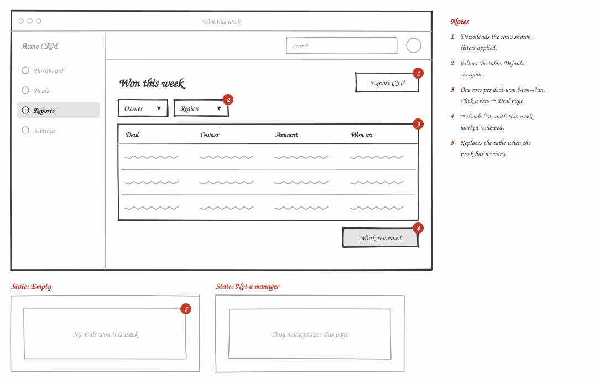

<p align="center">
  
</p>

<h1 align="center">shapeup-team</h1>

<p align="center"><em>Seven agents. One hill. Work gets done.</em></p>

---

You have an idea. Everyone has an idea.

The Shaper reads it, asks what people do today instead, and cuts it in half. Then cuts the half.
What's left fits on one page and says, in writing, what it won't do.

The betting table bets on it. Or it doesn't, and the pitch waits. Nothing carries over.

Then the crew walks up the hill.

**The designer** goes first, paintbrush in hand. Affordances before pixels. Has opinions about empty states.

**The frontend dev** follows with a code tag. Wires the screens to real data. Queries by role, never by CSS class.

**The backend dev** comes next with a gear. Thin handlers, fat models, a service for anything with a side effect. Writes the failing test first, every time, and commits it so you can check.

**The Shaper** stands at the top holding the flag. Not to celebrate. To mark the line: past it, nothing new gets figured out. It only gets made.

**QA** comes down the other side with a magnifier. Wrote "Done when" before anyone wrote code. Will not let you change a test to make it pass.

**The DBA** carries the database like it's fragile, because it is. In production: backups. Only backups. And asks first.

**DevOps** isn't in the picture. DevOps paved the road the others walk on: the pipeline that turns red before you do, the image built once,
the alert that says what to do. Puts each round's build on staging before you review it. Writes the release plan with a rollback in it. Production is yours: you press the button.

Every so often they stop and show you what works. Two reviews for a small batch, six for a big one. Near the end, the scope gets hammered.
When the reviews run out, the build stops. Nobody extends it but you.

They don't do standups. They write one row on the board and get back to work.

This plugin puts that crew inside Claude.

---

**What it is.** A Shape Up product team of Claude agents. The main Claude session is the **Conductor**: it runs the phases,
dispatches the roles and enforces the gates. The roles are stack-agnostic; **stack packs** teach them your stack.
A hook blocks what the team must never do: work outside its area, rewrite git history, deploy, or write to production.
The process is fixed. How each role solves its step is up to the role.

## Install

The repo is a plugin marketplace: the team, plus one plugin per stack pack. Install the team and the packs your project uses.

| Where | How |
|---|---|
| Claude Code | `/plugin marketplace add tiagoafseixas/shapeup-plugin`, then `/plugin install shapeup-team@shapeup` and each pack, e.g. `/plugin install stack-react-mui@shapeup` |
| Claude app | Build each `.plugin` file (`cd plugins/<name> && zip -r ../../<name>.plugin . -x '*.DS_Store'`) and upload it |

| Needs | For |
|---|---|
| `python3` on the PATH | The plugin's own tools: the guard hook, the doc scaffolder and the sketch renderer (standard library only). Your project can be in any language. |
| `gh` or `glab` (optional) | Draft PRs and marking them ready; set `PR tool` in `team.md`, or `none` to open PRs yourself |
| Anthropic's `frontend-design` skill (recommended) | The designer's visual judgment. Built into the Claude app; in Claude Code: `npx -y skills add anthropics/skills --skill frontend-design --agent claude-code` |
| [Ponytail](https://github.com/DietrichGebert/ponytail) (recommended) | Code review |

## How to use

A pitch goes through seven steps. You start each one; the team does the work and stops when it needs you.

| # | Step | You run | You get | Your part |
|---|---|---|---|---|
| 0 | Bootstrap the repo (once) | `/bootstrap` | The docs folder you choose (default `shape/`), `team.md` | Pick the docs folder; answer what the repo can't tell |
| 1 | Shape a pitch | `/shape <idea>`, later `/shape <slug>` | `pitch.md` with status `ready`, `log.md` | Shape it with the Shaper |
| 2 | Bet | "Prepare the betting table", then "We bet on `<slug>` for cycle `<id>`" | `shape/betting/<date>.md`; the pitch at status `bet` | Decide at your betting table |
| 3 | Kick off | `/kickoff <slug> <cycle>` | A branch, a draft PR, a board with scopes, `tech.md` | Answer questions about the environment |
| 4 | Build | `/round <slug>` | Working scopes to review at the end of each round | Review each round's scopes: accept or give findings |
| 5 | Ship | Starts by itself when you've accepted every must scope (or `/gate ship`) | The full suite green, a final review, the PR marked ready, a runbook if needed | Sign off the final review; merge the PR; run the runbook |
| 6 | Cool down | "I merged `<slug>`" | Status `shipped`; cut items in `shape/ideas.md`; a retro; the next betting table offered | Small fixes, if any; the next bets |

Steps 0 to 2 are offline: the team reads files and asks you. No GitHub calls, no database connections (local or production),
no test runs, no installs; the hook asks you before any of them while no pitch has a board. The kickoff is the first time anything runs.

### 0. Bootstrap the repo: `/bootstrap`

Run it once per repo, in the repo's root.

| What happens | Expected result |
|---|---|
| The Conductor asks where the team's docs should live: `shape/` (default), `docs/shape/` or your own folder | `.shapeup.json` at the repo root, recording the folder. Below, `shape/` stands for whatever you chose. |
| It creates the folder and fills `team.md` from the repo's files: `package.json`, requirements, settings, CI config | `shape/team.md`, `shape/ideas.md`, `shape/decisions.md`, empty `shape/pitches/` and `shape/betting/` |
| It asks you what files can't tell: the base branch, production database instance, the largest tables and their size (or "ask per pitch") | The Table volumes section filled with your numbers |
| It maps each developer role to a stack pack (`backend-drf` → `stack-django-drf`, …) and checks the packs are installed | The Roles table; a list of packs to install, if any are missing |
| It reads your UI's layout code (side nav or top bar, nav items, how lists and forms are built) and draws the app's frame for you to confirm | `shape/shell.txt` and a preview, `shape/shell.svg`: every sketch is drawn inside it |
| It looks for credentials in the repo's files | File paths with a connection string, if any; never their values |

Done when the Bootstrap gate passes. The team doesn't commit before a kickoff: commit `.shapeup.json` and the docs folder yourself.

### 1. Shape a pitch: `/shape`

Shaping is a conversation between you and the Shaper (the main session, best on Opus). It ends when the pitch is ready for the betting table.

| You say | The Shaper does | Expected result |
|---|---|---|
| `/shape send payment reminders for overdue invoices` | Proposes a title and slug for you to confirm, asks who asked for it and what the product is called, then who has the problem, what they do today, and what that costs, until the problem holds up without the solution | `shape/pitches/<slug>/pitch.md` (status `draft`) and `log.md` with the evidence and the agreed names |
| — | Proposes the appetite: Small batch (2 reviews with you) or Big batch (6) | The header table and a one-line Appetite |
| — | Tells the journey as numbered steps, one process per actor goal, and checks them with you | The processes you confirmed, in `log.md` |
| — | Draws the solution: one swimlane for the whole journey, one breadboard per process (`Step 1 · Place` … `Done`), and up to 4 rough sketches of new or changed screens, read from your real screens and drawn in your app's frame. It looks at every sketch before showing you. | Solution › Flow and Breadboard; Wireframes with one SVG per screen |
| — | Hunts rabbit holes, always including any step people do by hand. For technical ones it asks the backend, frontend or DBA agent for a read-only tech check of the code. | Rabbit holes, each with its patch; No-gos |
| — | Writes what "done" looks like from the user's side | Works when |
| `/shape <slug>` | Picks up where you left off, from `log.md` | — |

A sketch is a few lines of text in `wireframes/<screen>.txt`; `scaffold.py wireframe` draws it in your app's shell, grey, with
the pitch's parts in ink, numbered notes and extra states below it. Rough on purpose: nobody reviews pixels.
The flow and breadboards are Mermaid. GitHub draws the breadboards; the swimlane flow needs Mermaid ≥11.16 (beta), so older viewers show nothing, and the VS Code preview needs a Mermaid extension.



```text
title: Won this week
nav: Reports
# Won this week  >>  [Export CSV]^1
(Owner ▾)  (Region ▾)^2
| Deal | Owner | Amount | Won on | x3 ^3
>> [*Mark reviewed]^4
state: Empty
…
notes:
1 Downloads the rows shown, filters applied.
…
```

Every decision and its reason goes into `log.md`; the pitch states only the decisions. Done when the Ready gate passes
(problem, appetite, solution, rabbit holes, no-gos, ≤600 words, lint clean): the status becomes `ready`.

### 2. Bet

| You say | Expected result |
|---|---|
| "Prepare the betting table" | `shape/betting/<date>.md`: one row per `ready` pitch with its appetite, one-line problem and biggest remaining risk. It recommends nothing. |
| "We bet on `<slug>` for cycle `2026-C1`" | That pitch's status becomes `bet`, logged. Pitches not chosen stay `ready` for a later table; nothing is queued. |

### 3. Kick off: `/kickoff <slug> <cycle>`

| What happens | Expected result |
|---|---|
| Checks each role's stack pack is installed | Stops with the missing packs, if any |
| Creates the branch `cycle/<cycle>-<slug>` and the board | `shape/pitches/<slug>/board.md`; status `building` |
| Runs the environment for the first time: `gh auth status`, migrations on the local or test database, Small and Medium tests | Green, or a question to you; the team doesn't fix your environment |
| Commits, pushes, opens a draft PR | The PR link in the board header |
| Each developer role, the DBA and DevOps read the pitch and the code it touches | ≤3 notes each on the board |
| The backend roles draft the scopes, frontend roles amend them, the DBA marks the ones that touch the schema, DevOps the ones that need infrastructure (`Infra?`), QA writes "Done when", the Shaper checks them against the pitch | 2–7 scopes on the board: vertical slices named in domain words, each with an owner, must or `~` (nice to have) and checks |
| The DBA and the backend role draw the structure | `tech.md`: Mermaid entity, class and sequence diagrams and the API contract |

Done when the Kickoff gate passes. You get a 5-line summary: branch, PR, scopes, first scope, open questions.

### 4. Build: `/round <slug>`

A round runs from a goal to a review with you. The Conductor and the Shaper pick the scopes to finish this round; the team works
on them with no fixed order and no waiting: a handoff, a question or a QA finding is acted on as soon as it's on the board.

| Role | Does |
|---|---|
| Designer | Lays out the scope's screens first (affordances, copy, states) against the API contract, then does the visual pass once data is wired |
| Backend / frontend | Writes the Small and Medium tests first and commits them failing (`red`), then the code until they pass; hands the API contract to the frontend and migrations to the DBA |
| DBA | Reviews each migration against the table sizes in `team.md`: approve, or rewrite it safely |
| DevOps | Gives a scope what it needs to run (a setting, a secret's name, a job, a schedule, monitoring) as code on the cycle branch; keeps the pipeline green; promotes the build to staging before each review |
| QA | Writes the Large tests for the scope's journeys and runs the Scope gate as soon as a scope is handed over: tests by size, tests written first, no change-detector tests, every "Done when" check. Findings are nice-to-haves (`~`) unless they break a promise of the scope, as in Shape Up. |
| Shaper | Answers questions, cuts scope when the reviews run low, guards the no-gos |

| A round ends when | You get |
|---|---|
| Every scope of the round's goal has passed QA | **A review**: per scope, what it does, how to try it, screenshots when possible, what was cut. You accept each scope or give findings; findings become the next round's work. |
| A question blocks everything left | The question, at once, with options and a recommendation. The round continues after your answer. |
| The turn cap is reached (30 agent turns by default) | A status report instead of a demo. You choose: continue (it counts as a review) or hammer now. |

| Along the way | Where |
|---|---|
| One commit per turn (`S<n> <role>: …`), pushed at each review | The cycle branch and the draft PR |
| Each scope's hill position (0–50 figuring it out, 50–100 making it), `DONE` when QA passes it, accepted when you do | `board.md` |
| Questions that don't block anything | Collected for the review |

When a quarter of the reviews is left (Small: before review 2; Big: before review 5), the Shaper hammers the scope. When the last
review is done and must scopes remain, the build stops; the default is drop and re-shape, and only you extend.

### 5. Ship

Starts when you've accepted every must scope. QA runs the full suite, Large tests included, and the Ship gate. The DBA writes `runbook.md`
if the release needs manual steps (a backfill, an ordered deploy); DevOps adds its Release section when infrastructure, config or secrets
change: the strategy (rolling, canary, blue/green, a flag), what to watch and for how long, and the rollback. Then a **final review** with you: each "Works when" line of the pitch
with its evidence, the cut list and the runbook. It doesn't use the review budget.

Expected: after your sign-off, the PR marked ready and a 5-line summary of what shipped, what was cut and what the runbook says.
Only you merge, and you run the runbook.

### 6. Cool down

Tell the team you merged. As in Shape Up, cool-down is the break between cycles: no scheduled work, and the time for the next betting table.

Expected: status `shipped` (or `stopped`), reviews, turns and hours logged, cut items and shortcuts copied to `shape/ideas.md` (nothing carries over),
three retro rows on the board (keep, change, try), and an offer to prepare the next betting table. Small fixes you ask for meanwhile get their own branch and PR.

### Gates

A gate is the checklist a step must pass before the next one starts. The commands above run them for you; `/gate <name> <slug>`
runs one again by hand, and every result goes into `log.md`.

| Gate | Checked by | Ends step |
|---|---|---|
| Bootstrap | Conductor, with you | 0 |
| Ready | Shaper | 1 |
| Kickoff | Conductor | 3 |
| Scope (one per scope) | QA | Each scope in 4 |
| Review (one per round) | You | Each round in 4 |
| Final review | You | 5, before the PR is marked ready |
| Ship | QA, then the Conductor | 5 |

### Talking to one role

Name the role and the pitch: "DBA, review migration 0008 on deal-win-tracking", "frontend-react, pick up the handoff on S1",
"QA, run the scope gate on S2". The role works on the same board and log, but never starts a round or passes another role's gate.

### Appetite

Shape Up sizes work as a small batch (1–2 weeks) or a big batch (6 weeks). Agents don't work in weeks, so this plugin counts reviews
with you, about one per human week: **Small batch 2 reviews** (mid-way and near the end), **Big batch 6**. A turn cap per round (30)
bounds the agent work between reviews. All three numbers live in `team.md`.

## Shape Up, and what this plugin adds

The method is Basecamp's [Shape Up](https://basecamp.com/shapeup). What agents need on top of it is marked as an addition.

| Shape Up | In this plugin |
|---|---|
| Shaping by senior people: appetite, breadboards, fat-marker sketches, rabbit holes, no-gos | The user and the Shaper (`/shape`); designer and developers do read-only checks |
| A pitch: problem, appetite, solution, rabbit holes, no-gos | `pitch.md` with those five, plus wireframes and **Works when** (addition) |
| Betting table, no backlog | The betting pack and your bet; unchosen pitches stay `ready`, nothing is queued |
| Six-week cycle; small batch 1–2 weeks | **Review rounds** (addition): about one review with you per human week, so Small batch 2 reviews and Big batch 6; a turn cap bounds each round |
| A team of a designer and one or two programmers, QA later in the cycle | Designer, backend and frontend developers, QA; plus a **DBA** and **DevOps** (additions, optional) |
| Scopes, hill charts, get one piece done | Scopes on the board with a hill position; the first scope is the most core and most unknown |
| Scope hammering, must-haves and `~` nice-to-haves; QA issues are nice-to-haves unless the team decides otherwise | The same; the Shaper hammers when a quarter of the reviews is left |
| Circuit breaker; rare extensions | When the reviews run out the build stops; the default is drop and re-shape; only you extend |
| Cool-down: no scheduled work, the next betting table | The same, plus a short retro and cut items moved to `ideas.md` |
| — | **Additions for agents**: the Conductor, gates, "Done when" checks per scope, `log.md`, the board's message protocol, the testing and writing standards, stack packs, production and git guardrails, offline until kickoff |

## Commands

| Command | Does |
|---|---|
| `/shape [idea or slug]` | Shapes a pitch with the user; role agents run read-only tech checks; Ready gate |
| `/kickoff <slug> <cycle>` | Checks the stack packs, then the cycle branch, draft PR, board, scope map, `tech.md`, Kickoff gate |
| `/round <slug>` | Runs one review round: the team works on the round's scopes with no fixed order until there's something to review with you; applies the circuit breaker |
| `/bootstrap` | Once per repo: you pick the docs folder; fills `team.md` from the repo's files and your answers; offline |
| `/gate <ready / kickoff / scope S<n> / ship> <slug>` | Runs one gate again by hand and logs the result |
| `/stack [list / new <name> / house <role id> / lint <dir>]` | Lists the project's packs, writes a new pack from the stack's official docs, adds house rules |

## Roles

| Agent | Role | Default model | May edit (hook-enforced) |
|---|---|---|---|
| `shaper` | Shaper: answers questions during the build, hammers scope, guards no-gos | Sonnet | `shape/**` except `team.md` |
| `backend-dev` | Backend developer, any stack: domain, services, APIs, migrations | Sonnet | Its role's path from `team.md` › Roles; the pitch's `tech.md`, `board.md`, `log.md` |
| `designer` | Designer (optional): affordances, layout, copy and visual design; breadboards and wireframes while shaping. Uses Anthropic's `frontend-design` skill. | Sonnet | The UI path, except tests; the pitch's `board.md`, `log.md` |
| `frontend-dev` | Frontend developer, any stack: data, state, logic and tests of the screens (and their design when there's no designer) | Sonnet | Its role's path; the pitch's `tech.md`, `board.md`, `log.md` |
| `qa-engineer` | QA: "Done when" checks, Scope and Ship gates, Large tests | Sonnet | Test files; the pitch's `board.md`, `log.md` |
| `dba` | DBA, any database: migration review, indexes, runbooks, backups | Opus | Migrations; the pitch's `tech.md`, `runbook.md`, `board.md`, `log.md` |
| `devops` | DevOps (optional), any platform: pipeline, images, infrastructure as code, config and secret names, observability, the release plan; promotes to staging, never to production. | Sonnet (Opus for production IaC and release plans) | Its path; CI, Dockerfiles, IaC and manifests anywhere in the repo; the pitch's `tech.md`, `runbook.md`, `board.md`, `log.md` |

Shaping runs in the main session on Opus. The Conductor drops a turn to Haiku when the work is fully specified, and escalates one
step up when a turn fails. Call a role directly: "DBA, review migration 0008 on deal-win-tracking", "frontend-react, pick up S1".

## Stack packs

Three layers of knowledge, each with one job:

| Layer | Says | Lives in | Wins over |
|---|---|---|---|
| Process | What to do and when: tests first, handoffs, gates, guardrails | `shapeup-team` (role files, standards) | everything, on process |
| Stack pack | How, in this stack: layering, rules, test tools per size, performance, review checklist, indexed docs | one plugin per stack, e.g. `stack-react-mui` | the generic role file, on how |
| House rules | How, in this repo: only what differs from the pack | `shape/stack/<role id>.md` in your repo | the pack |

| Pack | Layer | Covers |
|---|---|---|
| `stack-django-drf` | backend | Django 5–6, DRF: thin views, fat models, service layer; pytest-django or the Django runner |
| `stack-nextjs-chakra` | frontend | Next.js App Router, React 18–19, Chakra UI v3 |
| `stack-react-mui` | frontend | React 18–19, Material UI v7 and v9, MUI X; Vite or Next.js |
| `stack-postgres-cloudsql` | database | PostgreSQL 13–18 on Cloud SQL: zero-downtime migrations (Django operations included), read-only user, backups |
| `stack-gcp-devops` | infra | Google Cloud: Cloud Build or GitHub Actions with Workload Identity Federation, Artifact Registry, Cloud Deploy, Cloud Run, GKE, Terraform, Secret Manager, Cloud Observability, SLOs and FinOps; follows the Professional Cloud DevOps Engineer guide |

Your project wires roles to packs in `shape/team.md`. Each developer role is an agent plus a pack; a project with two backends has two rows:

```markdown
| Role id        | Agent        | Stack pack              | Path      |
|----------------|--------------|-------------------------|-----------|
| backend-drf    | backend-dev  | stack-django-drf        | backend/  |
| frontend-react | frontend-dev | stack-react-mui         | ../web    |
| database       | dba          | stack-postgres-cloudsql | —         |
| devops-gcp     | devops       | stack-gcp-devops        | infra/    |
```

Moving from Chakra to MUI is one cell: change the pack, install it. No stack in the list? `/stack new <name>` scaffolds a pack,
indexes the stack's official docs into `references/sources.md`, writes the rules from them, and lints the result (`scaffold.py lint-pack`).
Every pack has the same sections, so the agents always know where to look.

## Guardrails (hook-enforced)

The guard runs before every `Write`, `Edit` and `Bash` call in a repo with `shape/team.md`, and on every call made by a team agent.

| Blocked | Asks the user first |
|---|---|
| Edits outside the role's area (Roles table); with a DevOps row, CI, Dockerfiles, IaC and manifests by anyone but DevOps | Before the first kickoff: any `gh` call, git remote call, install, database client, test run, container, `terraform init` or `curl` |
| | Any production connection: `$READONLY_DATABASE_URL`, a database client aimed at a remote host, `cloud-sql-proxy`, `gcloud sql` / `aws rds` reads (backend role and DBA only) |
| | Any cloud read: `gcloud` reads, `kubectl get`/`logs`, `helm status`, `terraform plan` (backend role, DBA and DevOps only) |
| `.env*` writes | `gcloud sql backups create`, `aws rds create-db-snapshot` (DBA only) |
| Force-push, push to `main`/`master`, merge, rebase, `gh pr merge`, `glab mr merge`, `--no-verify` | |
| Deploys and infrastructure changes, e.g. `deploy.sh`, `terraform apply`/`state rm`, `kubectl apply`/`exec`, `helm upgrade`, `docker push`, `fly deploy`, `vercel --prod`, any `gcloud` write (`deploy`, `create`, `update`, IAM bindings); migrations against shared databases (`flyway migrate`, `liquibase update`) | |
| Reading secret values: `gcloud secrets versions access`, `kubectl get secret -o yaml` | |
| | Allowed without asking, for DevOps only: a single promote, canary advance or rollback to `team.md` › Staging target or Staging project, and reads of that project; off when staging is the production project |
| Every other `gcloud sql` or `aws rds` write; any production access by the Shaper, designer, QA or frontend roles | |
| Any `…DATABASE_URL` other than `READONLY_DATABASE_URL`, `PGPASSWORD=`, `MYSQL_PWD=`, literal non-local database URLs, production settings | |

Production is off by default. When the backend role, the DBA or DevOps needs a production fact (table volumes, a plan, a service's config), it reads
`team.md` › Table volumes, then asks you: state it, run a read-only query it hands you, or let it connect read-only for that one
question. It connects only on that last answer, and the hook asks you again first. Backups by the DBA follow the same pattern.
Everything else in production becomes a runbook step for you. Only you merge.

## Standards the team follows

| Standard | Rule of thumb | File |
|---|---|---|
| Writing | Direct, affirmative, imperative; tables over prose; every block stands alone; decisions in docs, reasons in `log.md` | `references/writing-style.md` |
| Testing | Small (≤0.5 s, memory only) and Medium written before the code in a `red` commit; QA owns Large; DAMP; behaviour, not implementation; a test changes only when a source proves it wrong | `references/testing.md` |
| Diagrams | Mermaid: entity, class, sequence, state, activity; in pitches, one swimlane flow, a breadboard per process, ≤4 sketches drawn from text in the app's shell | `references/diagrams.md` |
| Messages | Board Log rows: NOTE, ASK, ANSWER, HANDOFF, BLOCK, FLAG, DECIDE, HUMAN, DONE; fixed turn report | `references/protocol.md` |

Paths are under `plugins/shapeup-team/skills/shapeup-team/`.

## What it creates in your repo

```
.shapeup.json              {"docs": "shape"}: the docs folder you chose at bootstrap
shape/                     or the folder you chose
  team.md                  roles and their stack packs, commands per role and size, table volumes, versions, budgets
  shell.txt, shell.svg     your app's frame (nav, brand, conventions) and its preview: every sketch is drawn in it
  stack/<role id>.md       house rules, when the repo differs from the pack
  ideas.md                 raw ideas, not a backlog
  decisions.md             conventions that outlive one pitch
  betting/<date>.md        betting pack for the betting table
  pitches/<slug>/
    pitch.md               one page: flow, breadboards and the embedded sketches
    wireframes/            <screen>.txt sketch sources and the <screen>.svg drawn from each
    log.md                 audit trail: every decision and action
    board.md               scopes, hill, message log, QA findings
    tech.md                Mermaid diagrams and API contract
    runbook.md             manual ops for the release, when needed
```

## Repository layout

| Path | Holds |
|---|---|
| `.claude-plugin/marketplace.json` | The `shapeup` marketplace: the team and the stack packs |
| `plugins/shapeup-team/` | The team: Conductor skill (process, role files, gates, standards, templates, `scaffold.py`), the six commands, seven agents, the guard hook |
| `plugins/stack-<name>/` | One stack pack each: `skills/stack-<name>/SKILL.md` and `references/sources.md` |
| `docs/` | Logo and the script that draws it (`python3 docs/make_logo.py` redraws the logo and the icon); `sketches/`, the sample sketches |
| `tests/` | Guard, sketch renderer and lint behaviour tests |
| `CHANGELOG.md` | One line per version of `shapeup-team` |

## Develop

| Task | Command |
|---|---|
| Run the tests | `pytest -q tests` |
| Redraw the sample sketches | `python3 plugins/shapeup-team/skills/shapeup-team/scripts/wireframe.py docs/sketches/<name>.txt --shell docs/sketches/shell.txt` |
| Validate the marketplace and each plugin | `claude plugin validate .`, then `claude plugin validate plugins/<name>` |
| Lint a stack pack | `python3 plugins/shapeup-team/skills/shapeup-team/scripts/scaffold.py lint-pack plugins/stack-<name>` |
| Lint a pitch | `python3 plugins/shapeup-team/skills/shapeup-team/scripts/scaffold.py lint <repo> <slug>` |
| Add a stack pack to the marketplace | `/stack new <name>` with `plugins/` as the location, then add it to `marketplace.json` |

## Sources

| Source | Used for |
|---|---|
| [Shape Up](https://basecamp.com/shapeup), Basecamp | Shaping, appetite, betting, scopes, hill charts, circuit breaker |
| [Ponytail](https://github.com/DietrichGebert/ponytail) | Minimal-code ladder and code review |
| [Test sizes](https://testing.googleblog.com/2010/12/test-sizes.html), [The way of TDD](https://testing.googleblog.com/2026/03/the-way-of-tdd.html), [DAMP tests](https://testing.googleblog.com/2019/12/testing-on-toilet-tests-too-dry-make.html), [Change-detector tests](https://testing.googleblog.com/2015/01/testing-on-toilet-change-detector-tests.html), Google Testing Blog | Testing standard |
| [The Elements of Style](https://www.gutenberg.org/ebooks/37134), Google and Microsoft style guides, plain-language guidelines | Writing standard |
| Each pack's `references/sources.md`: the official Django, DRF, Next.js, Chakra UI, Material UI, PostgreSQL and Cloud SQL docs | Stack packs |

## License

[MIT](LICENSE)
