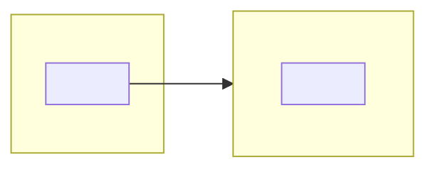

# {{title}}

| Status | Appetite | Shapers | Cycle | Updated |
|---|---|---|---|---|
| draft | <Small or Big batch> | User + Shaper | — | {{date}} |

Status: draft → ready → bet → building → shipped | dropped

## Problem
<Baseline: what users already do. Workaround: where it breaks and what they do instead. Cost: what the workaround costs them (time, money, risk). ≤5 lines, no solution words.>

## Appetite
<One imperative sentence: what this bet builds. Size lives in the header table. No justification, no other pitches.>

## Solution
<The elements, at fat-marker level: concrete enough to start, rough enough to leave design room.>

Breadboard: <the question it answers, e.g. "how a rep wins a deal and where the win shows up">

## Wireframes
<Only when a screen is new or its layout changes: one sketch per screen in wireframes/<screen>.txt, drawn in the app shell with
`scaffold.py wireframe` (notation: references/diagrams.md › Sketches), embedded here. Otherwise write "None: no screen changes.">

## Rabbit holes

| Risk | Patch (decision taken now) |
|---|---|
| | |

## No-gos
- <Explicitly out. The team must not build these, even if they look easy.>

## Works when
- <3–5 outcomes a user can observe. Not tasks.>

