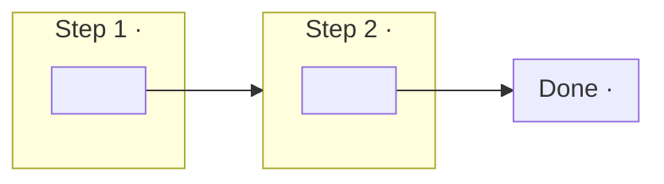

# {{title}}

| Status | Appetite | Shapers | Cycle | Updated |
|---|---|---|---|---|
| draft | <Small or Big batch> | User + Shaper | — | {{date}} |

Status: draft → ready → bet → building → shipped | dropped

## Problem
<Baseline: what users already do. Workaround: where it breaks and what they do instead. Cost: what the workaround costs them (time, money, risk). ≤5 lines, no solution words.>

## Appetite
<One imperative sentence: what this bet builds. Size lives in the header table. No justification, no other pitches.>

## Solution
<One sentence: who can do it, and the core constraint.>

### Flow
<The whole journey in one swimlane: the actors plus a touchpoint lane. Labels of 1–3 words, ≤15 nodes, side paths labelled on the edge.
Needs Mermaid ≥11.16; older viewers show nothing. No user-facing journey: write "None: no user-facing journey.">
```mermaid
swimlane-beta TB
  subgraph ActorA["<Actor>"]
    a1[<Step>]
  end
  subgraph Touch["<Email or notifications>"]
    t1[<Touchpoint>]
  end
  subgraph ActorB["<Actor>"]
    b1[<Step>]
  end
  a1 --> t1 --> b1
```

### Breadboard
<One per process (one actor goal), left to right in the order the actor acts, from the trigger to a Done place. Never combine processes.>

<Process>: <actor goal>


## Wireframes
<Only when a screen is new or its layout changes: ≤4 sketches, each in wireframes/<screen>.txt, drawn from the real screen's layout in
the app shell with `scaffold.py wireframe --png` and looked at (notation: references/diagrams.md › Sketches), embedded here.
Otherwise write "None: no screen changes.">


## Rabbit holes

| Risk | Patch (decision taken now) |
|---|---|
| | |

## No-gos
- <Explicitly out. The team must not build these, even if they look easy.>

## Works when
- <3–5 outcomes a user can observe. Not tasks.>

