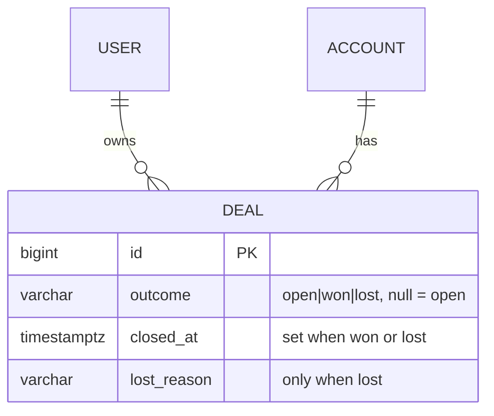
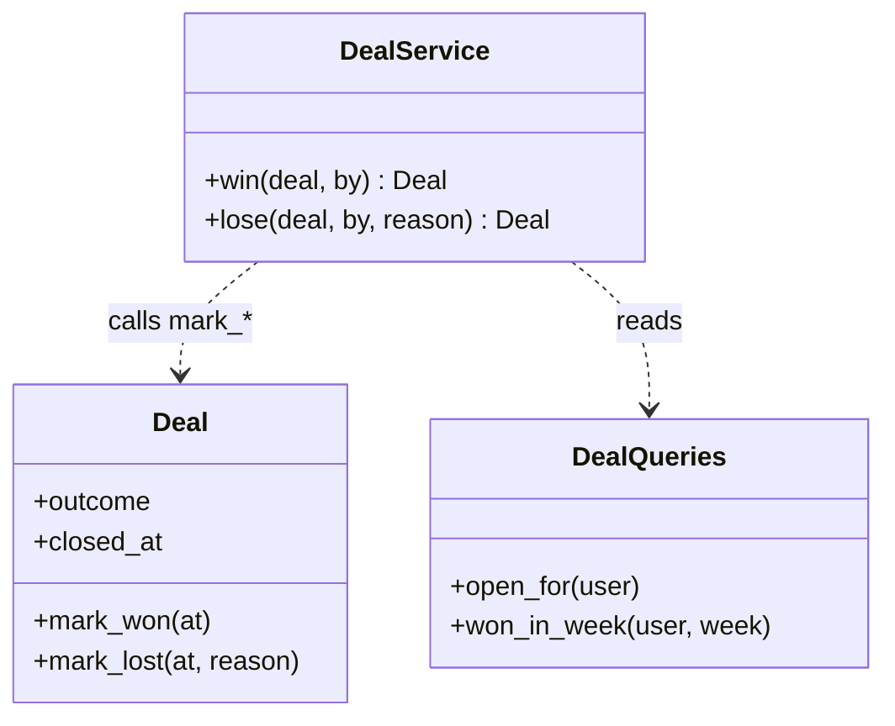
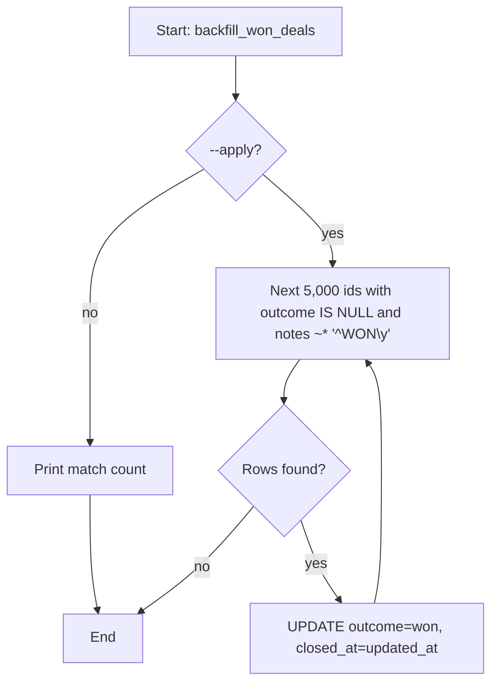
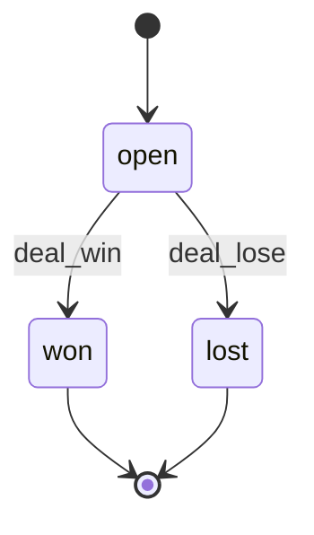
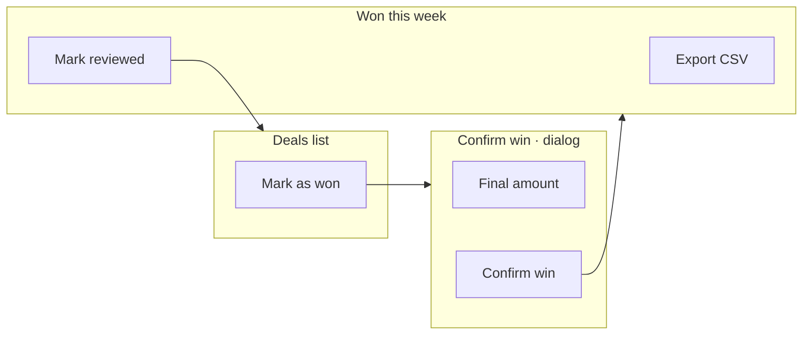

# Diagrams and wireframes

Diagrams replace prose about structure and order. They are written in Mermaid (renders on GitHub) and live in
`tech.md` (technical diagrams) or `pitch.md` (breadboard, sketches). Screen sketches are a few lines of text that
`scaffold.py wireframe` draws as hand-drawn SVGs inside the app's own shell. Draw one only when it answers a question
the code doesn't answer at a glance.

## Which diagram, when

| Diagram | Mermaid type | Draw it when | Owner | Lives in |
|---|---|---|---|---|
| Entity | `erDiagram` | A scope adds or changes tables, columns or relations | DBA | tech.md · Entities |
| Class | `classDiagram` | A scope adds models with domain methods, services or query objects that work together | backend | tech.md · Classes |
| Sequence | `sequenceDiagram` | A use case crosses 3+ participants (UI → API → service → DB → task/external) | backend (frontend for UI-only flows) | tech.md · Flows |
| Activity | `flowchart TD` (Mermaid has no activity type) | A process has branches, loops or retries: backfill, import, job | Owner of the process | tech.md · Processes |
| State | `stateDiagram-v2` | An entity has a lifecycle with rules about which transitions are allowed | backend | tech.md · Processes |
| Breadboard | `flowchart LR`: places as subgraphs, affordances inside, arrows to where each leads | Every pitch with a user-facing flow | Shaper + user (designer on a design check) | pitch.md · Solution |
| Sketch | `wireframes/<screen>.txt` → `scaffold.py wireframe` → `<screen>.svg`, embedded with `` | The pitch adds a screen or changes a screen's layout | Shaper + user (designer on a design check) | pitch.md · Wireframes |

## Rules

| # | Rule |
|---|---|
| 1 | Write one line above each diagram saying what question it answers ("How a deal is won"). |
| 2 | Draw only the changed parts plus their direct neighbours. Style nothing in Mermaid. |
| 3 | Use real names: model, field, endpoint, service, task. The diagram must match the code. |
| 4 | ≤15 nodes per diagram. Bigger means two questions, so draw two diagrams. |
| 5 | Show error paths that change behaviour (`alt` in sequence, a branch in flowchart). Skip trivial ones. |
| 6 | Update the diagram in the same commit that changes the code it shows. The Ship gate checks this. |
| 7 | Sketches stay fat-marker: places, affordances, rough position, real labels for actions. No colours, sizes or final copy; data is squiggles. The designer (or the frontend role) keeps the design room. |
| 8 | Sketches follow the app: they are drawn inside `<docs>/shell.txt`, and follow its conventions (lists, forms, page actions). A screen that breaks a convention says why in a note. |

## Skeletons

Entity: what the deal tables look like after this bet


Class: how the model, the queries and the service split the win logic


Sequence: how a deal is won
```mermaid
sequenceDiagram
    actor Rep
    participant UI as DealCard
    participant API as POST /api/deals/{id}/win/
    participant S as deal_win()
    participant DB as Database
    Rep->>UI: Mark won
    UI->>API: POST
    API->>S: deal_win(deal, by=user)
    S->>DB: SELECT … FOR UPDATE; UPDATE deal
    alt already closed
        S-->>API: DealError
        API-->>UI: 409 "Deal already closed"
    else ok
        S-->>API: deal
        API-->>UI: 200 DealOutput
    end
```

Activity: how the backfill runs


State: which outcome transitions are allowed


Breadboard: how a rep wins a deal and where the win shows up


## Sketches

A sketch is a text file per screen in `<docs>/pitches/<slug>/wireframes/<screen>.txt`. `scaffold.py wireframe <repo> <slug>`
draws each one as `<screen>.svg`: the app shell in grey with the current nav item highlighted, the pitch's parts in ink,
numbered markers, notes in the margin and extra states beside the screen. Embed each SVG under the pitch's Wireframes
heading: ``. The `.txt` is the source: edit it, redraw, commit both.
`scaffold.py lint` flags a sketch whose SVG is stale or not embedded.

### The app shell

`<docs>/shell.txt` holds the frame every sketch sits in, so sketches look like this app: side nav or top bar, the nav
items, brand, account menu, global search, how the nav collapses on a phone, and the app's screen conventions.
It is filled at `/bootstrap` by reading the layout code (the layout component, app shell or base template; files only,
offline) and confirmed with the user: `scaffold.py wireframe <repo>` draws `<docs>/shell.svg` to show them.
The designer, or the frontend role, updates it when the shell changes.

| Key | Values | Drawn as |
|---|---|---|
| `layout` | `side`, `top`, `side+top`, `none` | Side nav, top bar, both, or no app chrome |
| `brand` | text | Name at the top of the nav |
| `nav` | `Item \| Item \| Item` | Nav items; a sketch's `nav:` line highlights one |
| `account` | `top-right`, `bottom`, `none` | Avatar in the top bar, or at the foot of the side nav |
| `search` | `yes`, `no` | Search box in the top bar |
| `mobile` | `bottom-tabs`, `menu` | Phone: tab bar with the nav items, or a ☰ menu |
| `lists`, `forms`, `page actions` | `table`/`cards`, `page`/`dialog`/`drawer`, `top-right`/`bottom`/`inline` | Not drawn: conventions the sketch author follows |

### Notation

Header lines (optional, first): `title:` (window title; default: the first heading), `screen: desktop | mobile`,
`frame: page | dialog | drawer | none` (`none` for an email or an embed, no shell), `nav:` (the nav item to highlight).
Then one row per line, top to bottom. Tokens in a row sit side by side; `>>` pushes the rest of the row to the right.

| Write | Draws |
|---|---|
| `# Title` / `## Subtitle` | Page heading / section heading |
| `[Label]` / `[*Label]` | Button / primary button |
| `{Label}` / `{{Label}}` | Text input / text area |
| `(Label ▾)` | Select |
| `[ ]` `[x]` / `( )` `(x)` then a label | Checkbox / radio |
| `<Label>` | Link |
| plain text, or `"text"` | A label |
| `\| Col \| Col \| x4` | Table with 4 rows of squiggle data |
| `cards: Title x3` | 3 cards (title optional) |
| `tabs: One \| *Two \| Three` | Tabs, `*` = active |
| `~~~ x2` | 2 lines of body text (squiggles) |
| `[# Chart]` | Image or chart placeholder |
| `? No deals won this week` | Empty or message box |
| `--` | Divider |
| `^1` after a token or at the end of a row | Numbered marker; explained under `notes:` |
| `. ` at the start of a row | Grey: exists today and doesn't change (use it on a changed screen) |
| `state: Empty` | Starts another state of the screen, drawn beside it |
| `notes:` then `1 What it does → where it leads` | The margin notes: each marker's behaviour and destination |
| `// text` | A comment, not drawn |

Sketch: the Won this week page (`wireframes/won-this-week.txt`)
```text
title: Won this week
nav: Reports
# Won this week  >>  [Export CSV]^1
(Owner ▾)  (Region ▾)^2
| Deal | Owner | Amount | Won on | x3 ^3
>> [*Mark reviewed]^4

state: Empty
# Won this week
? No deals won this week

notes:
1 Downloads the rows shown, filters applied.
2 Filters the table. Default: everyone.
3 One row per deal won Mon–Sun. Click a row → Deal page.
4 → Deals list, with this week marked reviewed.
```

Sketch: the confirm dialog (`wireframes/confirm-win.txt`)
```text
title: Deals
frame: dialog
nav: Deals
## Mark "Northwind renewal" as won
{Final amount}^1
{Won on}  (Reason ▾)
[x] Notify the account owner
>> [Cancel]  [*Confirm win]^2
notes:
1 Prefilled with the deal amount.
2 → Won this week, the deal highlighted.
```

| Do | Don't |
|---|---|
| One sketch per place that is new or changes layout; a dialog is its own sketch with `frame: dialog` | Sketch screens the pitch doesn't change |
| Real labels on actions and headings: they are the affordances | Final copy for body text, sample data, colours, icons |
| A note for every marker: what it does and where it leads (match the breadboard) | Notes that explain the layout; the picture does that |
| Extra states (empty, no permission, error) as `state:` blocks when they change what the user can do | A state per edge case: those go in Rabbit holes |
