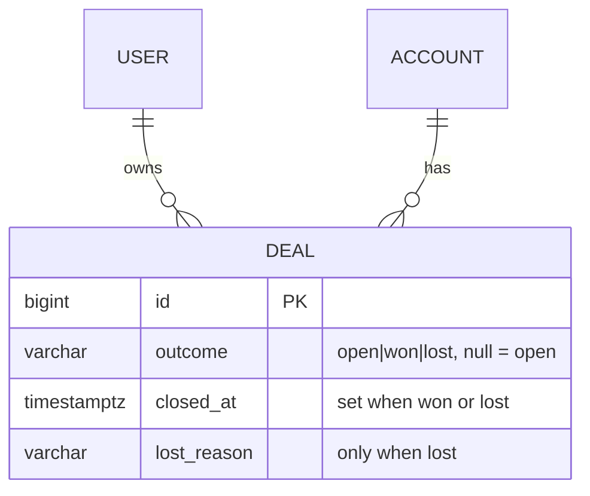
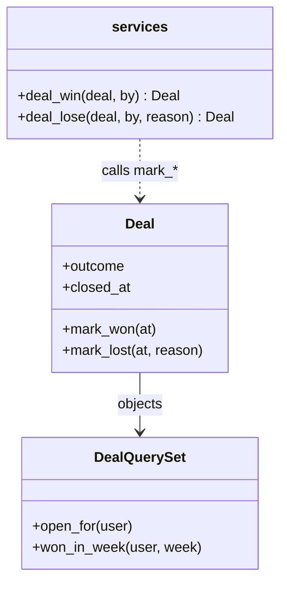
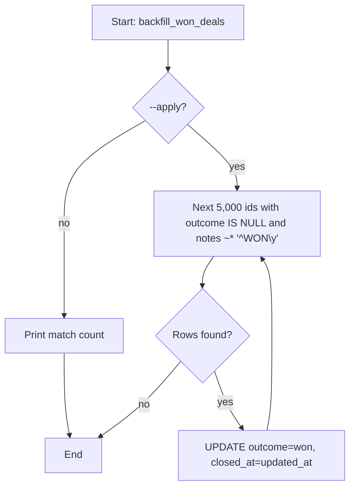
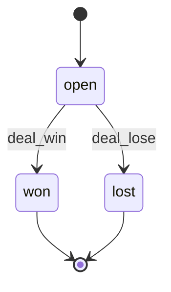

# Diagrams and wireframes

Diagrams replace prose about structure and order. They are written in Mermaid (renders on GitHub) and live in
`tech.md` (technical diagrams) or `pitch.md` (wireframes, breadboard). Draw one only when it answers a question
the code doesn't answer at a glance.

## Which diagram, when

| Diagram | Mermaid type | Draw it when | Owner | Lives in |
|---|---|---|---|---|
| Entity | `erDiagram` | A scope adds or changes tables, columns or relations | DBA | tech.md · Entities |
| Class | `classDiagram` | A scope adds models with domain methods, services or QuerySets that work together | backend-drf | tech.md · Classes |
| Sequence | `sequenceDiagram` | A use case crosses 3+ participants (UI → API → service → DB → task/external) | backend-drf (frontend-react for UI-only flows) | tech.md · Flows |
| Activity | `flowchart TD` (Mermaid has no activity type) | A process has branches, loops or retries: backfill, import, job | Owner of the process | tech.md · Processes |
| State | `stateDiagram-v2` | An entity has a lifecycle with rules about which transitions are allowed | backend-drf | tech.md · Processes |
| Wireframe | ASCII in a ` ```text ` block | The pitch adds a screen or changes a screen's layout | PO + CTO | pitch.md · Wireframes |

## Rules

| # | Rule |
|---|---|
| 1 | Write one line above each diagram saying what question it answers ("How a deal is won"). |
| 2 | Draw only the changed parts plus their direct neighbours. Grey out nothing, style nothing. |
| 3 | Use real names: model, field, endpoint, service, task. The diagram must match the code. |
| 4 | ≤15 nodes per diagram. Bigger means two questions, so draw two diagrams. |
| 5 | Show error paths that change behaviour (`alt` in sequence, a branch in flowchart). Skip trivial ones. |
| 6 | Update the diagram in the same commit that changes the code it shows. The Ship gate checks this. |
| 7 | Wireframes stay fat-marker: boxes, labels, affordances, rough position. No colours, sizes, fonts or exact copy. frontend-react keeps the design room. |

## Skeletons

Entity: what the deal tables look like after this bet


Class: how the model, QuerySet and service split the win logic


Sequence: how a deal is won
```mermaid
sequenceDiagram
    actor Rep
    participant UI as DealCard
    participant API as POST /api/deals/{id}/win/
    participant S as deal_win()
    participant DB as Postgres
    Rep->>UI: Mark won
    UI->>API: POST
    API->>S: deal_win(deal, by=user)
    S->>DB: SELECT … FOR UPDATE; UPDATE deal
    alt already closed
        S-->>API: DealError
        API-->>UI: 409 "Deal already closed"
    else ok
        S-->>API: deal
        API-->>UI: 200 DealOutput
    end
```

Activity: how the backfill runs


State: which outcome transitions are allowed


Wireframe: the Won this week page
```text
+--------------------------------------------------+
| Deals | [Won this week]                           |
+--------------------------------------------------+
|  < prev    Week 46 · 10–16 Nov    next >          |
|                                                  |
|  Ana Lopes            EUR 12,400 · USD 3,000      |
|    • Acme renewal       EUR 8,000   Tue           |
|    • Beta pilot         USD 3,000   Thu           |
|  Rui Costa            EUR 0  (no wins)            |
|                                                  |
|  [empty week → "No deals won this week"]          |
+--------------------------------------------------+
```
